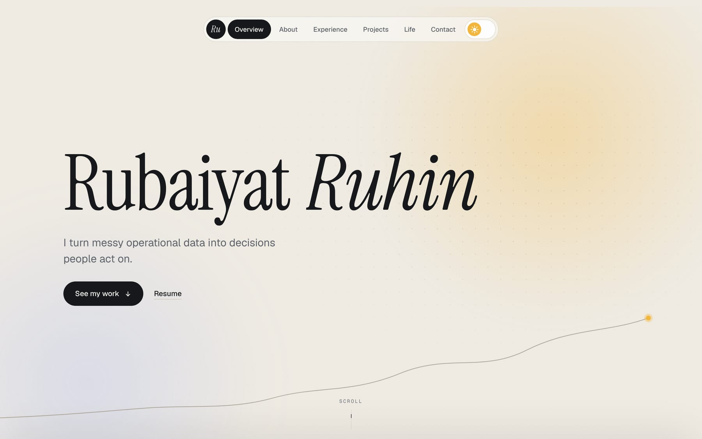
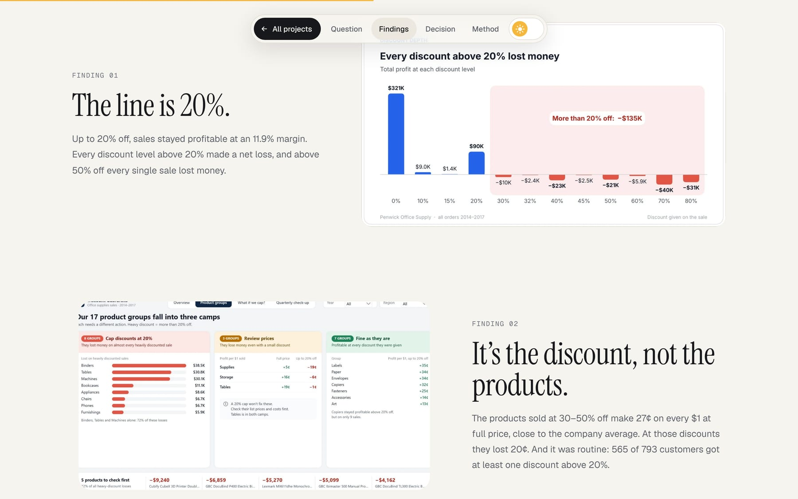
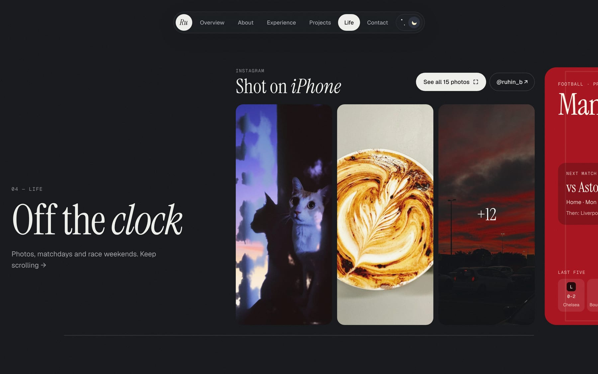

# rubaiyat.dev

The portfolio of **Rubaiyat (Ru) Ruhin**, a data analyst in Adelaide. Case studies in SQL, Python and Power BI, plus a little of life outside work.

**→ [rubaiyat.dev](https://rubaiyat.dev)** · [LinkedIn](https://linkedin.com/in/rubaiyatalamruhin) · [Analysis projects](https://github.com/ruhinb/Data_Analysis_Projects)

<picture>
  <source media="(prefers-color-scheme: dark)" srcset="docs/screenshots/home-dark.jpg">
  
</picture>

## What's on the site

- **Three case studies**, each written like a short report: the question, the findings with the actual Power BI pages, the decision, and how it was built.
  - [PatientCare Analytics](https://rubaiyat.dev/projects/patientcare): where missed clinic appointments concentrate, and the reminder change that cut them.
  - [Discount Guardrails](https://rubaiyat.dev/projects/discount): the discount level where a retailer starts losing money.
  - [Slice & Co. Pizza Operations](https://rubaiyat.dev/projects/slice): rushes, basket size and rostering for a flat year of sales.
- **Experience and resume**, with the resume viewable and downloadable on the page.
- **Life**: photos from my iPhone, what I'm listening to on Spotify right now, and live Manchester United and Formula 1 cards.



## How it's built

| Part         | What I used                                                                                                                |
| ------------ | -------------------------------------------------------------------------------------------------------------------------- |
| Framework    | Next.js 16 (App Router), React 19, TypeScript                                                                              |
| Styling      | Tailwind CSS 4; light and dark themes from one set of colour variables                                                     |
| Motion       | Native CSS scroll-driven animations, with a GSAP fallback for browsers that don't support them yet; Lenis smooth scrolling |
| Live data    | Spotify Web API, football-data.org and Jolpica (F1), all fetched on the server and cached, so no keys reach the browser    |
| Hosting      | Vercel, deployed from `main`                                                                                               |
| Stats        | Umami: no cookies, served through the site's own domain                                                                    |
| Tests and CI | Playwright end-to-end tests in Chrome and Safari (WebKit) on every pull request; `main` only accepts changes that pass     |

A few details I cared about:

- **Fast and static.** Every page is pre-built. The home page refreshes itself every 15 minutes so the football and F1 cards stay current, and the now-playing card checks Spotify every 30 seconds only while the tab is open.
- **Private by default.** Photos have their location data stripped before upload, the email address never appears whole in the HTML, and the visitor stats record nothing personal ([privacy page](https://rubaiyat.dev/privacy)).
- **Locked down.** Strict security headers, including a Content Security Policy that only allows the site's own scripts. There's no login, database or form to attack.
- **Works everywhere.** Tested at widths from 320px phones to 1920px monitors, with keyboard navigation, focus handling in dialogs, and reduced motion respected.
- **Shareable.** Each page draws its own link-preview image at build time, in the site's fonts, so links look right on LinkedIn, Slack and WhatsApp.



## Run it locally

Needs Node.js 22.

```bash
npm install
cp .env.example .env.local
LIVE_DATA_FIXTURES=1 npm run dev   # http://localhost:3000, with stand-in data instead of live API keys
```

`npm run check` runs lint, type checks and formatting; `npm run build && npm run test:e2e` runs the Playwright tests against a production build. Notes on updating content are in [docs/MAINTAINING.md](docs/MAINTAINING.md).

## Licence

The code is here to read and learn from. The writing, case studies, photos and resume are mine and aren't licensed for reuse.
